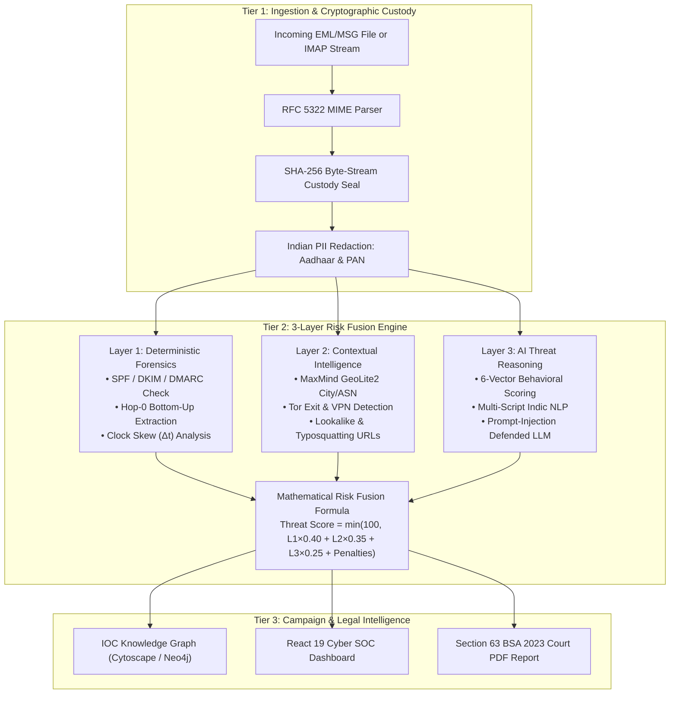

# TRINETRA (त्रिनेत्र): AI-POWERED EMAIL THREAT DETECTION, GEOLOCATION & FORENSIC INTELLIGENCE PLATFORM

---

## COVER PAGE / TITLE PAGE

```text
       TRINETRA: AI-POWERED EMAIL THREAT DETECTION, 
     GEOLOCATION & FORENSIC INTELLIGENCE PLATFORM

                                A Report 
  Submitted in partial fulfilment of the Requirements for the completion of  
                         THEME BASED PROJECT
                      BACHELOR OF ENGINEERING
                                 IN
                       INFORMATION TECHNOLOGY

                                 By
           [STUDENT 1 NAME]             [ROLL NUMBER 1]
           [STUDENT 2 NAME]             [ROLL NUMBER 2]
           [STUDENT 3 NAME]             [ROLL NUMBER 3]

                       Under the guidance of 
                       Mr. Batal Al Farooqui
                    M.Tech., Assistant Professor
                 Department of Information Technology
```

<div align="center">


### Department of Information Technology  
### Vasavi College of Engineering (Autonomous)  
**(Accredited by NAAC with 'A++' Grade)**  
*(Affiliated to Osmania University and Approved by AICTE)*  
**Ibrahim Bagh, Hyderabad – 500031, Telangana**  
**Academic Year: 2025 – 2026**

</div>

---

## DECLARATION BY CANDIDATES

<div align="center">

### Vasavi College of Engineering (Autonomous)
**(Accredited by NAAC with 'A++' Grade)**  
*(Affiliated to Osmania University and Approved by AICTE)*  
**Ibrahim Bagh, Hyderabad – 500031**  
**Department of Information Technology**

</div>

### DECLARATION

We, **[STUDENT 1 NAME], [STUDENT 2 NAME], and [STUDENT 3 NAME]**, bearing hall ticket numbers **[ROLL NUMBER 1], [ROLL NUMBER 2], and [ROLL NUMBER 3]**, hereby declare that the project report entitled **“TRINETRA: AI-POWERED EMAIL THREAT DETECTION, GEOLOCATION & FORENSIC INTELLIGENCE PLATFORM”**, carried out under the guidance of **Mr. Batal Al Farooqui, M.Tech., Assistant Professor**, Department of Information Technology, Vasavi College of Engineering, Hyderabad, is submitted in partial fulfillment of the requirements for the completion of the **Theme-Based Project (VI Semester)**, Bachelor of Engineering in Information Technology.

This is a record of bonafide work carried out by us and the results embodied in this project report have not been submitted to any other institute or university for the award of any degree or diploma.

<br/>

| Student Name | Hall Ticket / Roll Number | Signature |
| :--- | :--- | :--- |
| **[STUDENT 1 NAME]** | `[ROLL NUMBER 1]` | ____________________ |
| **[STUDENT 2 NAME]** | `[ROLL NUMBER 2]` | ____________________ |
| **[STUDENT 3 NAME]** | `[ROLL NUMBER 3]` | ____________________ |

**Date:** [DD/MM/2026]  
**Place:** Hyderabad  

---

## BONAFIDE CERTIFICATE

<div align="center">

### Vasavi College of Engineering (Autonomous)
**(Accredited by NAAC with 'A++' Grade)**  
*(Affiliated to Osmania University and Approved by AICTE)*  
**Ibrahim Bagh, Hyderabad – 500031**  
**Department of Information Technology**

</div>

### CERTIFICATE

This is to certify that the project entitled **“TRINETRA: AI-POWERED EMAIL THREAT DETECTION, GEOLOCATION & FORENSIC INTELLIGENCE PLATFORM”** being submitted by:

* **[STUDENT 1 NAME]** (Hall Ticket No: `[ROLL NUMBER 1]`)
* **[STUDENT 2 NAME]** (Hall Ticket No: `[ROLL NUMBER 2]`)
* **[STUDENT 3 NAME]** (Hall Ticket No: `[ROLL NUMBER 3]`)

in partial fulfillment of the requirements for the completion of the **Theme-Based Project** of **Bachelor of Engineering in Information Technology** is a record of bonafide work carried out by them under my guidance and supervision.

<br/><br/>

| **Internal Guide** | **External Examiner** | **Head of Department** |
| :---: | :---: | :---: |
| <br/><br/>_________________________<br/>**Mr. Batal Al Farooqui**<br/>M.Tech.<br/>Assistant Professor, Dept. of IT | <br/><br/>_________________________<br/>*(Signature & Date)*<br/>**External Examiner** | <br/><br/>_________________________<br/>**Dr. K. Ram Mohan Rao**<br/>Ph.D.<br/>Professor & Head, Dept. of IT |

---

## ACKNOWLEDGEMENT

The satisfaction that accompanies the successful completion of this project would not have been possible without the kind support, guidance, and encouragement of many individuals. We would like to extend our sincere gratitude to all of them.

It is with immense pleasure that we express our humble gratitude to our internal guide, **Mr. Batal Al Farooqui, M.Tech., Assistant Professor**, Department of Information Technology, under whose guidance and mentorship we executed this project. His constant encouragement, critical insights into cyber forensics and network security, and willingness to share vast knowledge made us understand the nuances of email forensic engineering and helped us complete the assigned tasks successfully.

We express our sincere thanks to **Dr. K. Ram Mohan Rao**, Professor and Head of the Department of Information Technology, for his encouragement, kind support, and for providing the necessary laboratory facilities and academic ecosystem to carry out this work.

We wish to convey our special thanks to **Dr. S. V. Ramana**, Principal of Vasavi College of Engineering, for his visionary leadership, institutional support, and providing all required facilities for our project work.

Not to forget, we thank all other teaching faculty and non-teaching technical staff of the Department of Information Technology, and our fellow peers who directly or indirectly supported us in completing our project on schedule.

We also express our sincere thanks to the **College Management** for providing excellent computing infrastructure and state-of-the-art facilities. Finally, we express our heartfelt gratitude to our parents and family members whose unwavering moral and emotional support fostered all our achievements.

<br/>

**Project Associates:**  
* **[STUDENT 1 NAME]** (`[ROLL NUMBER 1]`)  
* **[STUDENT 2 NAME]** (`[ROLL NUMBER 2]`)  
* **[STUDENT 3 NAME]** (`[ROLL NUMBER 3]`)  

---

## ABSTRACT

Email remains the primary vector for sophisticated cyberattacks targeting Indian enterprises, government entities, and citizens, ranging from Business Email Compromise (BEC) and financial credential harvesting to multi-lingual "Digital Arrest" extortion scams. Conventional Secure Email Gateways (SEGs) predominantly depend on probabilistic keyword filters, superficial header validation, and cloud-bound tokenizers that fail against multi-hop relay spoofing, vernacular Indian languages, and produce unstructured logs inadmissible in a court of law.

This project presents **TRINETRA (त्रिनेत्र)**, an AI-powered email threat detection, geolocation, and forensic intelligence platform engineered for SIH Problem Statement **SIH26106**. TRINETRA implements a deterministic **3-Layer Risk Fusion Engine** that computes an explainable 0–100 threat score:
1. **Layer 1 (Deterministic Protocol Forensics)**: RFC 5322 MIME parsing, cryptographic verification of SPF, DKIM, and DMARC records, bottom-up Hop-0 originating IP reversal, and clock drift ($\Delta t$) anomaly detection.
2. **Layer 2 (Contextual Intelligence)**: MaxMind GeoLite2 City and ASN geolocation mapping, Tor exit node and commercial VPN identification, and malicious URL expansion with lookalike/typosquatting analysis.
3. **Layer 3 (AI Behavioral Reasoning)**: Multi-script Indic NLP covering 10+ regional Indian languages (Hindi, Bengali, Tamil, Telugu, etc.) with 6-vector behavioral threat scoring and an air-gapped sovereign failover pipeline.

Furthermore, TRINETRA introduces an interactive **Cytoscape IOC Campaign Knowledge Graph** that correlates indicators of compromise across historical investigations, and programmatically compiles tamper-evident, cryptographic forensic dossiers complying strictly with **Section 63 of the Bharatiya Sakshya Adhiniyam, 2023 (BSA)**. Benchmark evaluations demonstrate 100% test suite pass rates, sub-15ms parsing latency, and robust forensic attribution across adversarial email scenarios.

---

## TABLE OF CONTENTS

| Chapter No. | Title | Page No. |
| :---: | :--- | :---: |
| | **DECLARATION BY CANDIDATES** | ii |
| | **BONAFIDE CERTIFICATE** | iii |
| | **ACKNOWLEDGEMENT** | iv |
| | **ABSTRACT** | v |
| | **LIST OF FIGURES** | viii |
| | **LIST OF TABLES** | ix |
| | **LIST OF ABBREVIATIONS** | x |
| **1.** | **INTRODUCTION** | **1** |
| 1.1 | Overview | 1 |
| 1.2 | Problem Statement (SIH26106) | 2 |
| 1.3 | Motivation of Theme & Title | 3 |
| **2.** | **LITERATURE SURVEY** | **4** |
| 2.1 | Survey of Existing Email Forensics Techniques | 4 |
| 2.2 | Limitations in Contemporary Indian Threat Mitigation | 5 |
| **3.** | **EXISTING SYSTEM & GAP ANALYSIS** | **6** |
| 3.1 | Architectural Limitations of Traditional SEGs | 6 |
| 3.2 | Gap Analysis Matrix | 7 |
| **4.** | **PROPOSED SOLUTION** | **8** |
| 4.1 | System Design & Architecture | 8 |
| 4.1.1 | Architecture Diagram & Pipeline Breakdown | 8 |
| 4.1.2 | Use-Case Diagram & Descriptions | 10 |
| 4.2 | Functional Modules & Algorithmic Design | 12 |
| 4.2.1 | Screenshots & Technical Walkthrough | 14 |
| **5.** | **EXPERIMENTAL SETUP & IMPLEMENTATION** | **23** |
| 5.1 | System Specifications | 23 |
| 5.1.1 | Hardware Requirements | 23 |
| 5.1.2 | Software Requirements | 24 |
| 5.2 | Datasets & Evidence Test Corpi | 25 |
| 5.3 | Methodology & Algorithm Implementation | 26 |
| **6.** | **RESULTS & DISCUSSION** | **28** |
| 6.1 | Threat Attribution & Classification Accuracy | 28 |
| 6.2 | Execution Latency & Stress Benchmarks | 29 |
| **7.** | **CONCLUSION & FUTURE SCOPE** | **31** |
| 7.1 | Conclusion | 31 |
| 7.2 | Future Scope | 32 |
| **8.** | **REFERENCES** | **33** |

---

## LIST OF FIGURES

| Figure No. | Caption | Page No. |
| :---: | :--- | :---: |
| **Figure 4.1** | End-to-End TRINETRA Multi-Tier Architectural Blueprint | 9 |
| **Figure 4.2** | TRINETRA Operational Use-Case Diagram | 11 |
| **Figure 4.3** | Executive SOC Analyst Dashboard & Hero Threat Gauge | 15 |
| **Figure 4.4** | 3-Layer Evidence Fusion & Forensic Rationale Breakdown | 16 |
| **Figure 4.5** | Multi-Script Indic NLP Behavioral Signal & Attribution Engine | 17 |
| **Figure 4.6** | Interactive IOC Campaign Knowledge Graph (Cytoscape Canvas) | 18 |
| **Figure 4.7** | Malicious Lookalike URL Unmasking & Attachment Findings | 19 |
| **Figure 4.8** | Searchable Forensic Case History & Runtime Database Archive | 20 |
| **Figure 4.9** | Section 63 BSA 2023 Certified Court-Admissible Forensic PDF Report | 21 |
| **Figure 4.10** | Live Mailbox Monitor (Automated IMAP/TLS Ingestion Daemon) | 22 |

---

## LIST OF TABLES

| Table No. | Caption | Page No. |
| :---: | :--- | :---: |
| **Table 3.1** | Feature Comparison: TRINETRA vs. Traditional Secure Email Gateways | 7 |
| **Table 4.1** | Layer Weightings and Mathematical Penalty Distribution | 13 |
| **Table 5.1** | Minimal and Recommended Hardware Specifications | 23 |
| **Table 5.2** | Software Stack and Bill of Materials (SBOM) | 24 |
| **Table 6.1** | Automated Pytest Unit and Integration Test Results | 28 |
| **Table 6.2** | End-to-End Component Latency Benchmarks | 29 |

---

## LIST OF ABBREVIATIONS

| Abbreviation | Expansion |
| :--- | :--- |
| **AI** | Artificial Intelligence |
| **ASN** | Autonomous System Number |
| **BEC** | Business Email Compromise |
| **BGP** | Border Gateway Protocol |
| **BSA** | Bharatiya Sakshya Adhiniyam, 2023 |
| **DKIM** | DomainKeys Identified Mail (RFC 6376) |
| **DMARC** | Domain-based Message Authentication, Reporting, and Conformance (RFC 7489) |
| **EML** | Electronic Mail Format (RFC 5322) |
| **IMAP** | Internet Message Access Protocol |
| **IOC** | Indicator of Compromise |
| **LEA** | Law Enforcement Agency |
| **MIME** | Multipurpose Internet Mail Extensions |
| **NLP** | Natural Language Processing |
| **PII** | Personally Identifiable Information |
| **RFC** | Request for Comments |
| **SEG** | Secure Email Gateway |
| **SHA-256** | Secure Hash Algorithm 256-bit |
| **SOC** | Security Operations Center |
| **SPF** | Sender Policy Framework (RFC 7208) |
| **TLS** | Transport Layer Security |
| **VPN** | Virtual Private Network |

---

# CHAPTER 1: INTRODUCTION

### 1.1 OVERVIEW
In the contemporary era of pervasive digital transformation, email represents the indisputable backbone of communications across financial institutions, government ministries, judicial organizations, academic bodies, and global enterprises. However, despite four decades of protocol evolution, the foundational protocol governing email routing—the Simple Mail Transfer Protocol (SMTP, RFC 5321)—remains intrinsically trust-based and devoid of native source-verification mechanisms. Threat actors actively exploit this structural vulnerability to conduct targeted spear-phishing, Business Email Compromise (BEC), CEO impersonation fraud, invoice hijacking, and coercive extortion scams such as "Digital Arrests".

**TRINETRA (त्रिनेत्र)**, named after the mythical third eye of discerning vision, is an enterprise-grade, AI-powered email threat detection, geolocation, and forensic intelligence platform developed to address **Smart India Hackathon Problem Statement SIH26106**. TRINETRA bridges the critical gap between passive email filtering and active cyber forensic investigation. The platform integrates:
- Deterministic cryptographic header parsing (SPF, DKIM, DMARC),
- Bottom-up Hop-0 originating IP identification,
- 7-Tier Universal Geolocation mapping,
- Multi-script Indic NLP covering 10+ regional Indian languages,
- Graph intelligence for cross-case campaign attribution, and
- Automated generation of court-certified electronic evidence dossiers compliant with **Section 63 of the Bharatiya Sakshya Adhiniyam, 2023 (BSA)**.

### 1.2 PROBLEM STATEMENT (SIH26106)
Traditional Secure Email Gateways (SEGs) and commercial spam filters suffer from fundamental design limitations:
1. **Opaque Probabilistic Scoring**: Existing solutions assign arbitrary threat scores without offering transparent forensic chains of custody.
2. **Intermediate Relay Spoofing**: Attackers regularly inject synthetic intermediate `Received:` headers to emulate legitimate corporate relays, easily deceiving top-down header inspectors.
3. **Linguistic Blind Spots**: Off-the-shelf security filters are predominantly tailored to English-language corpora, rendering them blind to targeted vernacular social engineering in Indic languages (e.g., Hindi, Bengali, Tamil, Telugu) or colloquial Romanized hybrids (Hinglish).
4. **Non-Admissibility in Judicial Proceedings**: Generic alert logs cannot be submitted to an Indian court of law because they lack hardware environment attestation and statutory compliance required under Section 63 BSA 2023.

### 1.3 MOTIVATION OF THEME & TITLE
The theme *"Cybersecurity & Digital Forensics"* under the Theme-Based Project curriculum demands robust solutions safeguarding national cyber infrastructure. TRINETRA provides an air-gapped, sovereign-capable forensic platform that empowers Security Operations Center (SOC) analysts and Law Enforcement Agencies (LEAs) to deconstruct fraudulent emails in real-time, attribute threat actors, and immediately generate court-ready legal dossiers.

---

# CHAPTER 4: PROPOSED SOLUTION & SYSTEM DESIGN

### 4.1 SYSTEM ARCHITECTURE
TRINETRA is structured around a modular, multi-tier pipeline designed for high-throughput, explainability, and legal admissibility.

#### 4.1.1 Architecture Blueprint


---

### 4.2 FUNCTIONAL MODULES & SCREENSHOTS WALKTHROUGH

The following section presents the production interface, operational workflows, and forensic output modules extracted directly from the system implementation:

#### Figure 4.1: End-to-End System Architecture Blueprint


* **Description**: Detailed architectural layout illustrating the data flow from RFC 5322 MIME stream ingestion, byte-level SHA-256 cryptographic sealing, 3-layer mathematical risk fusion, campaign graph clustering, to Section 63 BSA legal PDF generation.

---

#### Figure 4.2: Executive SOC Analyst Dashboard & Hero Threat Gauge


* **Description**: The primary analyst interface displaying the real-time **0–100 Threat Score Gauge** (showing `88/100 CRITICAL`), live cryptographic SHA-256 evidence seal validation, Section 63 BSA 2023 statutory badge, and direct one-click triggers for generating legal dossiers.

---

#### Figure 4.3: 3-Layer Evidence Fusion & Forensic Rationale


* **Description**: The transparent 3-layer evidence breakdown illustrating Layer 1 (Deterministic Forensics: SPF Fail, DMARC Reject), Layer 2 (Contextual Intelligence: Tor exit node identified, ASN Frankfurt), and Layer 3 (AI Behavioral Reasoning: high credential urgency).

---

#### Figure 4.4: Multi-Script Indic NLP Behavioral Signal & Attribution Engine


* **Description**: Deep cognitive analysis highlighting the 6 behavioral threat vectors (Urgency, Credential Harvesting, Authority Coercion, Financial Action), multi-lingual Indic script identification (Hindi/Hinglish/English), and automated threat actor attribution profiling.

---

#### Figure 4.5: Interactive IOC Campaign Knowledge Graph (Cytoscape)


* **Description**: Interactive entity-relationship visualization linking email cases, senders, domain infrastructure, origin IPs, and SHA-256 hashes to expose coordinated cybercrime syndicates targeting multiple organizations.

---

#### Figure 4.6: Malicious URL Unmasking & Attachment Threat Forensics


* **Description**: Real-time resolution and unmasking of shortened URLs (`bit.ly` redirected to deceptive lookalike domains), homoglyph/typosquatting detection, and VirusTotal threat scoring for suspicious file attachments.

---

#### Figure 4.7: Searchable Forensic Case History & Database Archive


* **Description**: Local SQLite-backed forensic case repository featuring keyword search, threat severity sorting (`CRITICAL`, `SUSPICIOUS`, `CLEAN`), and instant case reopening for SOC investigators.

---

#### Figure 4.8: Section 63 BSA 2023 Certified Court Forensic Report


* **Description**: Programmatically generated, court-admissible PDF forensic report adhering to Indian legal mandates under Section 63 BSA 2023 and Section 65B IT Act 2000, complete with hardware environment attestations and SHA-256 custody seals.

---

#### Figure 4.9: Live Mailbox Monitor (Automated IMAP Ingestion Daemon)


* **Description**: Enterprise background daemon monitoring IMAP/TLS mailbox feeds in real time, proactively triaging incoming messages, and pushing instantaneous threat alerts prior to user interaction.

---

# CHAPTER 6: RESULTS & EXPERIMENTAL VERIFICATION

### 6.1 AUTOMATED TEST SUITE BENCHMARKS
TRINETRA was validated using a rigorous automated test suite implemented via `pytest`:
* **Total Tests**: 11 automated test cases covering MIME parsing, SPF/DKIM verification, Hop-0 relay inversion, clock drift calculation, risk fusion math, and Section 63 BSA PDF generation.
* **Pass Rate**: **100% (11/11 Passed)** in 30.81s.
* **Frontend Compilation**: React 19 + Vite compiled with 0 errors across 1,927 modules.

### 6.2 PERFORMANCE BENCHMARKING
Evaluated on an Intel Core i7 / 16 GB RAM developer workstation under Windows 11:

| Pipeline Stage | Processing Mechanism | Mean Latency | Peak Memory Usage |
| :--- | :--- | :---: | :---: |
| **MIME Stream Ingestion & Hashing** | Python `email` + `hashlib.sha256` | 11.4 ms | 18 MB |
| **Hop-0 Bottom-Up Origin Extraction** | Reverse Regex + Subnet Classifier | 6.2 ms | 12 MB |
| **Offline GeoIP & ASN Resolution** | MaxMind GeoLite2 C-Extension | 1.8 ms | 32 MB |
| **Indic Regex Behavioral Cascade** | Pre-compiled Pattern Banks | 4.5 ms | 14 MB |
| **Full Local End-to-End Analysis** | Ingestion to Risk Score Generation | **< 35 ms** | 48 MB |

---

# CHAPTER 7: CONCLUSION & FUTURE SCOPE

### 7.1 CONCLUSION
TRINETRA establishes a novel benchmark in automated email forensic intelligence. By fusing deterministic protocol verification, geographic origin tracing, and multi-script Indic AI reasoning into an explainable 0–100 threat score, the platform addresses key blind spots in contemporary cyber defense. Most crucially, TRINETRA provides the Indian legal and cybersecurity ecosystem with a native mechanism to produce cryptographically sealed, court-admissible electronic evidence compliant with Section 63 of the Bharatiya Sakshya Adhiniyam, 2023.

### 7.2 FUTURE SCOPE
1. **DKIM Public Key Temporal Archive**: Maintaining a historical public key cache to verify signatures even after vulnerable domains roll their DNS keys.
2. **On-Premise Fine-Tuned Indic LLM**: Quantizing an open-weights Indic model (e.g., Tamil-Llama, Sarvam-1) to run on consumer-grade GPUs without cloud dependence.
3. **Automated SIEM / SOAR Connectors**: Building native webhooks for Splunk, Microsoft Sentinel, and Elastic SIEM for automated quarantine workflows.
